T & T Fashion Store
A PHP and MySQL e-commerce web application for browsing fashion products, managing a shopping cart, placing orders, and administering an online fashion store.
Table of Contents
Project Overview
Features
Technology Stack
Application Screenshots
Project Structure
Database
Requirements
Installation and Setup
Running the Application
Security and Configuration Notes
Future Improvements
Developer

Project Overview
T & T Fashion Store is a web-based shopping application designed to make fashion products available through an online storefront. Customers can explore the product catalogue, view product information, add items to a cart, and submit orders through the checkout process.
The application also contains an administration area for managing store information and day-to-day activities, including products, orders, customers, reports, and settings.
The project is built primarily with PHP and MySQL, with HTML, CSS, JavaScript, and Bootstrap used for the user interface.
Features

Customer-facing features
Browse the fashion store homepage and product catalogue.
View individual product details.
Browse products by category.
Add products to the shopping cart.
Change quantities and remove cart items.
Register a customer account and sign in.
Proceed through the checkout page and submit an order.
Access customer-related pages available in the application.
Administration features
Access the administration area.
View the admin dashboard.
Manage products.
Manage customer orders.
View customer information.
View reports.
Manage store settings.

The available features may depend on the configuration and database used when running the project.
Technology Stack
Technology	Role
PHP	Server-side application logic
MySQL	Relational database
HTML5	Page structure
CSS3	Styling and layout
JavaScript	Browser-side interactions
Bootstrap 5	Responsive interface components
Bootstrap Icons	Interface icons
Git	Version control
GitHub	Source-code hosting
Docker	Optional container configuration; see the project Docker files

Application Screenshots
The screenshots below are stored in the repository's `screenshots/` folder. They provide a visual tour of the customer storefront and administration area.
Tip: Select any screenshot image to open the full-size image on GitHub.
1. Store homepage
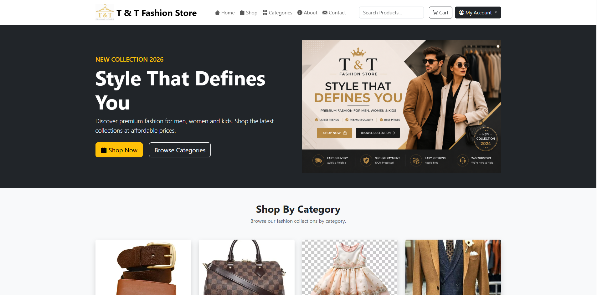
The homepage is the main entry point to the store.
Open homepage screenshot
2. Product catalogue
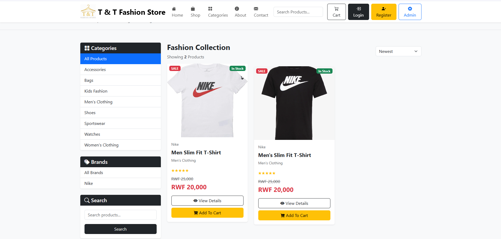
The product catalogue displays fashion items available in the store.
Open product catalogue screenshot
3. Product details
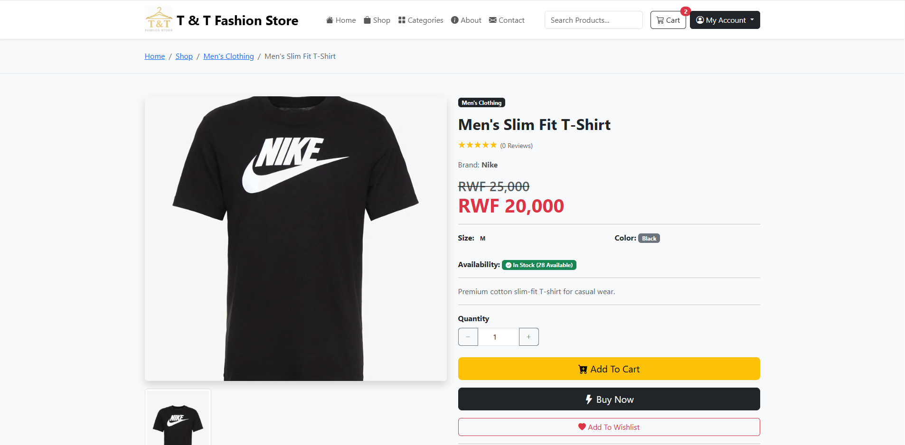
The product details page presents information about a selected item.
Open product details screenshot
4. Shopping cart
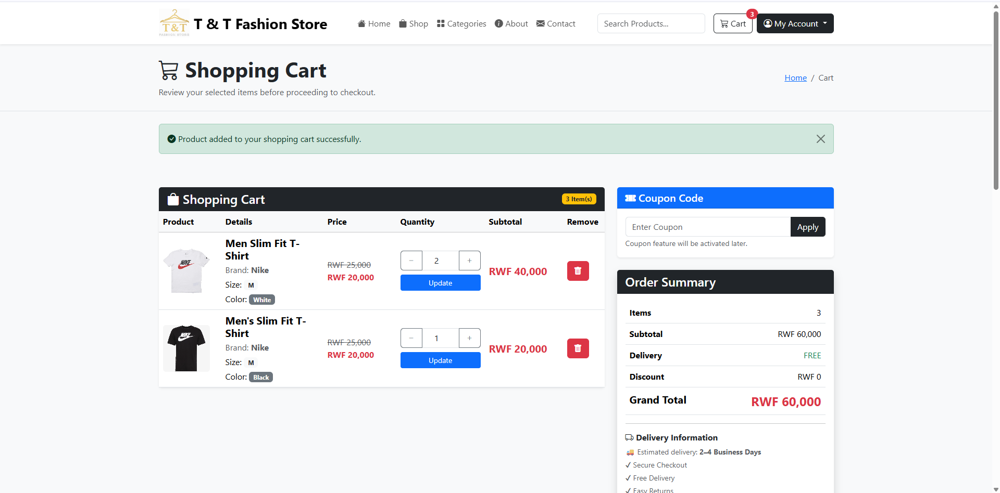
The shopping cart lets customers review the items they have selected.
Open shopping cart screenshot
5. Checkout
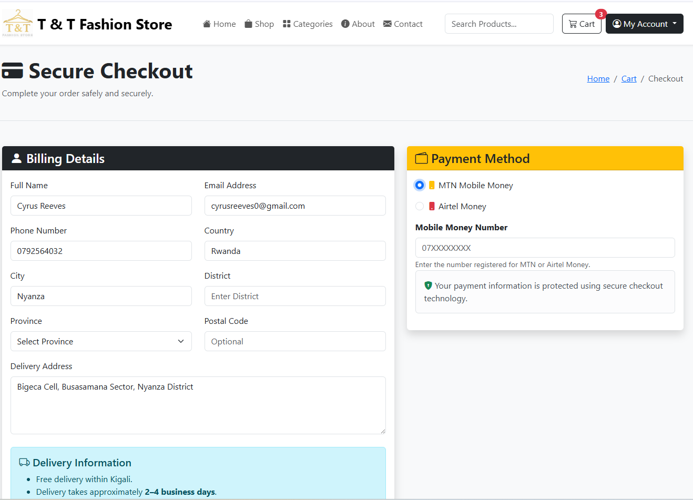
The checkout page is used to review an order and provide the required order information.
Open checkout screenshot
6. Customer login
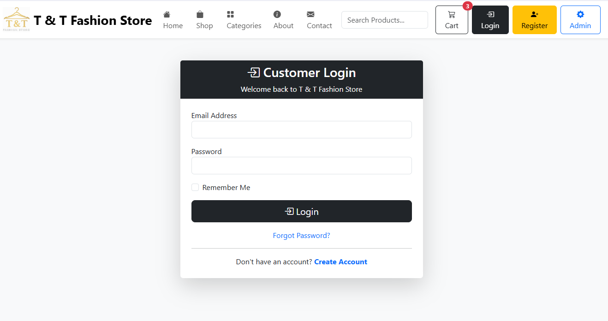
The login page provides access for registered customers.
Open login screenshot
7. Admin dashboard
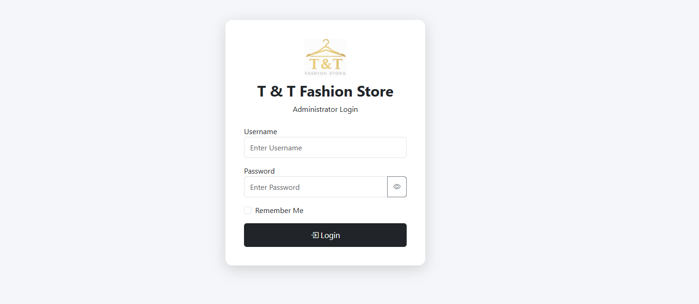
The administration dashboard provides an overview of store management.
Open admin dashboard screenshot
8. Product management
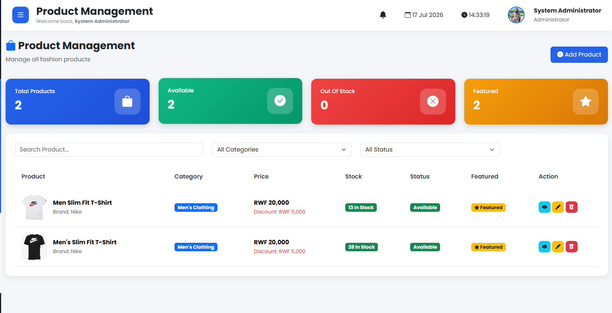
The product management interface is used to maintain the store catalogue.
Open product management screenshot
9. Order management
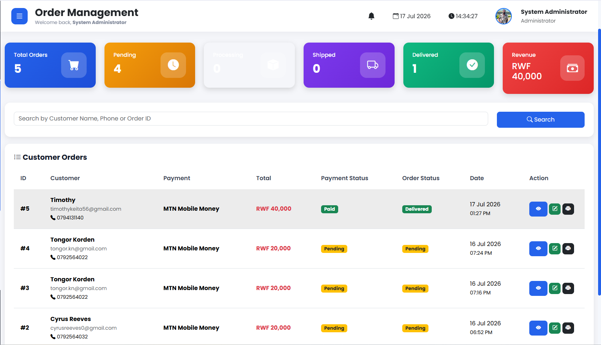
The order management interface displays customer orders for administration.
Open order management screenshot
10. Customer management
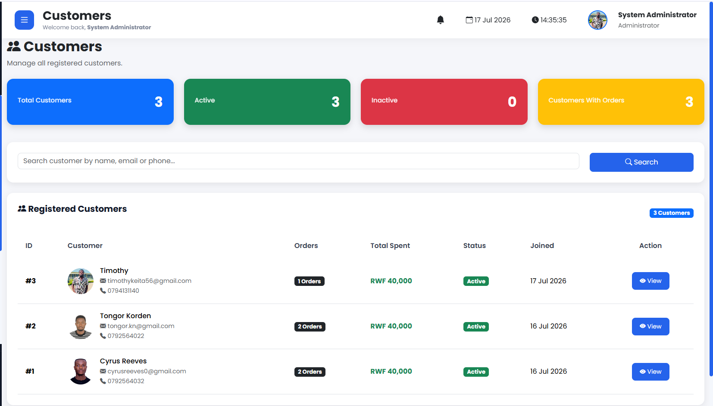
The customer management page displays customer records.
Open customer management screenshot
11. Reports
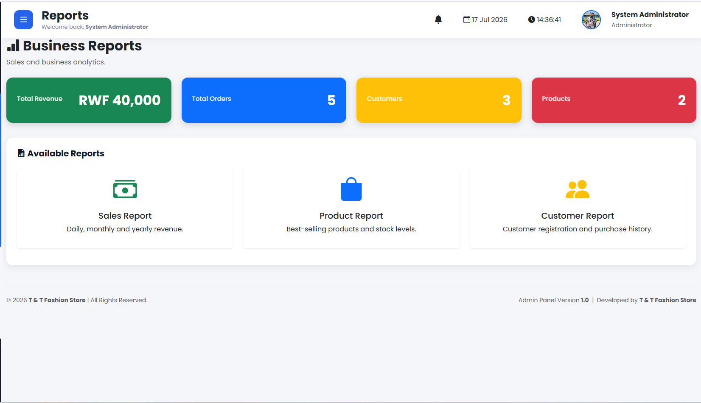
The reports page presents store information for administrative review.
Open reports screenshot
12. Store settings
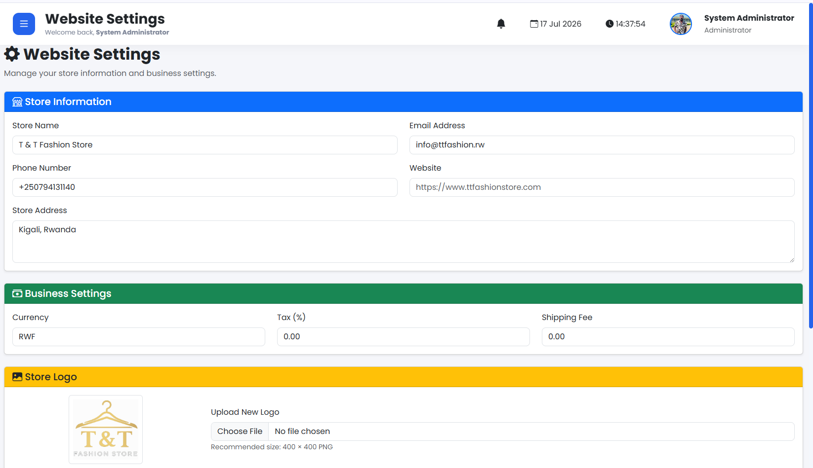
The settings page provides controls for configuring store information.
Open settings screenshot

Project Structure
The main folders and files include:
```text
T-T-Fashion-Store/
│
├── .github/
├── account/
├── admin/
├── api/
├── assets/
├── cart/
├── checkout/
├── config/
├── customer/
├── database/
├── includes/
├── products/
├── screenshots/
│   ├── 01-homepage.png
│   ├── 02-products.png
│   ├── 03-product-details.png
│   ├── 04-shopping-cart.png
│   ├── 05-checkout.png
│   ├── 06-login.png
│   ├── 07-admin-dashboard.png
│   ├── 08-manage-products.png
│   ├── 09-manage-orders.png
│   ├── 10-customers.png
│   ├── 11-reports.png
│   └── 12-settings.png
│
├── .gitignore
├── 404.php
├── about.php
├── cart.php
├── categories.php
├── checkout.php
├── contact.php
├── Dockerfile
├── docker-compose.yml
├── index.php
├── login.php
├── logout.php
├── order_success.php
├── place-order.php
├── product.php
├── README.md
├── register.php
├── setup_admin.php
├── shop.php
└── tt_fashion_store (1).sql
```
This is a guide to the visible project layout. The exact contents may change as the project is maintained.
Database
The project includes a MySQL database export named:
```text
tt_fashion_store (1).sql
```
The database is used by the application to store the information required for the store, such as products, categories, customer accounts, and orders.
The SQL export should be reviewed before importing it into a production database. Do not publish real customer information, password data, or other private records.

Requirements
To run the project locally, you will need:
Windows, macOS, or Linux.
PHP supported by the installed XAMPP or PHP environment.
MySQL or MariaDB.
Apache (included with XAMPP).
A modern web browser.
Visual Studio Code or another code editor (optional).
Installation and Setup
The following instructions describe a typical local setup with XAMPP.
1. Get the project
Clone the repository after it has been published to your GitHub account:
```bash
git clone https://github.com/Cyrus9262/T-T-Fashion-Store.git
```
Alternatively, download the repository as a ZIP file from GitHub and extract it.
2. Place the project in XAMPP
Copy the project folder into the XAMPP web directory. For a typical Windows installation, this is:
```text
C:\xampp\htdocs\
```
The resulting folder should be:
```text
C:\xampp\htdocs\T-T-Fashion-Store\
```
3. Start Apache and MySQL
Open the XAMPP Control Panel and start:
Apache
MySQL
4. Create the database
Open `http://localhost/phpmyadmin` in your browser.
Create a database for the project. The existing project documentation used the name `t_t_fashion_store`; confirm the database name expected by the current application configuration.
Select the new database.
Open the Import tab.
Choose `tt_fashion_store (1).sql` from the project folder.
Start the import and wait for it to complete.
If the SQL file is moved or renamed, select its new location when importing.
5. Configure the database connection
Open the database configuration file inside the project's `config/` directory. Set the database host, database name, username, and password to match your local MySQL setup.
For a default local XAMPP installation, the values are often:
```text
Host: localhost
Username: root
Password: (blank by default)
```
Use the actual configuration file and variable names in this project. Do not commit real passwords or private credentials to GitHub.
6. Open the application
Visit:
```text
http://localhost/T-T-Fashion-Store/
```
If your project folder has a different name, use that folder name in the URL.
Running the Application
After completing the setup:
Confirm Apache and MySQL are running.
Confirm the project database has been imported.
Confirm the database connection settings are correct.
Open the local application URL in your browser.
Test the customer pages and administration pages using appropriate test accounts.
Do not publish default administrator credentials. If the application requires an initial administrator account, use the project's setup process locally and create a secure password.
Security and Configuration Notes
Before publishing or deploying the application:
Keep `.env` files and private configuration files out of version control.
Never commit database passwords, API keys, access tokens, or private credentials.
Use test data instead of real customer or business records.
Do not publish private administrator or customer login details.
Review uploaded files and database exports for personal or confidential information.
Use HTTPS and secure production configuration when deploying the application.
Review authentication, authorization, input validation, and database queries before production use.
The repository's `.gitignore` excludes several common local and generated files. Review it before the first push to confirm that all project-specific secrets and private files are excluded.

Future Improvements
Possible areas for future development include:
Integration with a supported online payment provider.
Email or SMS order notifications.
Product search and advanced filtering.
Wishlist functionality.
Inventory and stock notifications.
Discount and coupon management.
Improved sales analytics.
Delivery tracking.
Automated testing and deployment.
These are potential enhancements and should not be considered implemented unless they are added to the application.

Developer
GitHub: Cyrus9262
This repository is part of a software development portfolio demonstrating practical work with PHP, MySQL, web application development, and e-commerce functionality.
---
Project: T & T Fashion Store